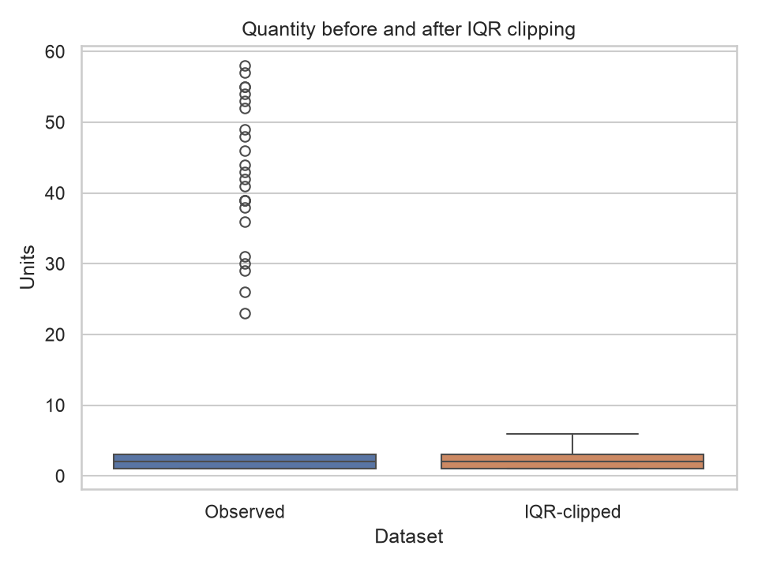
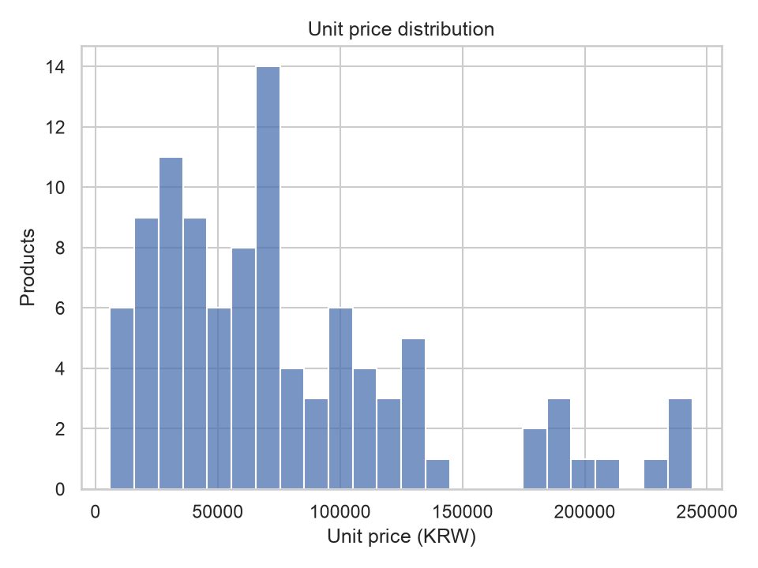
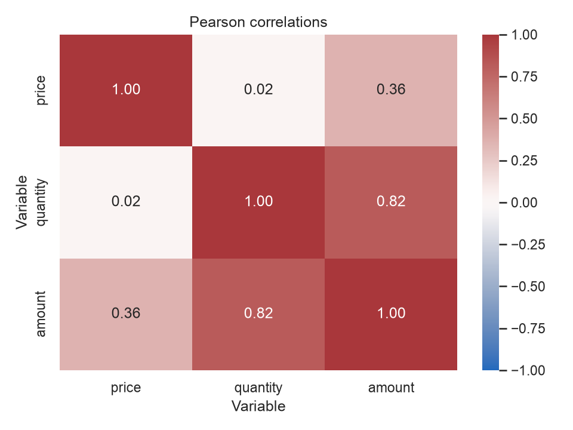
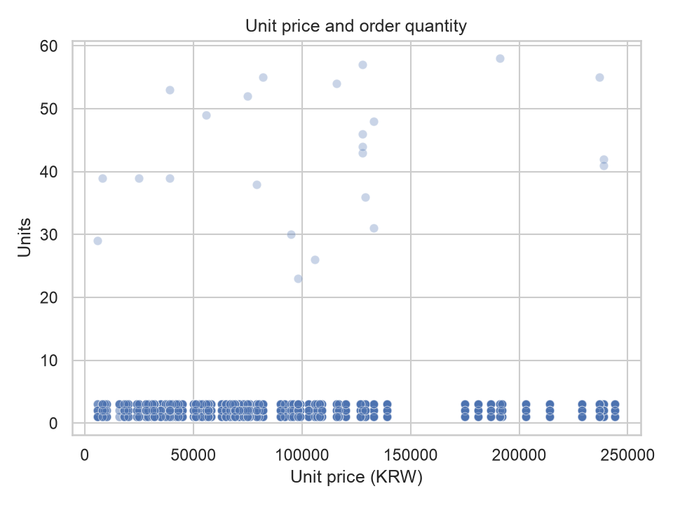
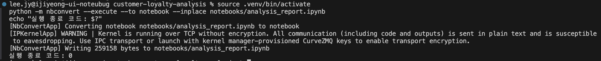

# 쇼핑몰 단골 고객 분석

쇼핑몰 고객의 구매 기록을 분석해 최근에 구매한 고객, 자주 구매한 고객, 구매금액이 큰 고객을 파악하는 프로젝트입니다. 코디세이 AI/SW 심화 데이터 분석 과제에 맞춰 서로 다른 형태의 데이터를 정리하고, 통계와 시각화로 구매 패턴을 살펴본 뒤, RFM 분석으로 고객을 네 그룹으로 분류했습니다. 분석 결과를 바탕으로 고객군별 실행 방법과 효과를 검증할 방법까지 제안합니다.

Python으로 구현했으며 NumPy는 이미지 배열 계산에, Pandas는 표 형태의 데이터 처리와 집계에 사용했습니다. 시각화에는 Matplotlib와 Seaborn을 사용하고, 코드와 실행 결과는 Jupyter Notebook에 기록했습니다. 아래에서는 데이터의 구성부터 전처리, 분석 결과, 고객 분류, 설계 이유와 한계까지 차례대로 설명합니다.

## 데이터셋과 생성 가정

분석 데이터는 실제 쇼핑몰이나 고객의 정보를 수집하지 않고 직접 만든 합성 데이터입니다. **합성 데이터 사용은 과제 담당자의 허용을 전제로 합니다.** 생성 코드는 고정된 난수 시드 `20251117`을 사용합니다. 난수 시드는 무작위 숫자를 만드는 출발점으로, 같은 실행 환경과 시드에서 데이터를 다시 생성해 결과를 비교할 수 있도록 설정했습니다.

| 항목 | 기본 시드로 생성한 데이터 |
|---|---|
| 관측 기간 | 2025년 1월 1일~12월 31일입니다. |
| 고객 | 가상 고객 500명입니다. |
| 상품 | 가상 상품 100개입니다. |
| 주문 | 고유 주문 3,877건입니다. |
| 거래행과 컬럼 | 상품 거래행 7,738개와 원본 컬럼 10개입니다. |
| 카테고리 | 의류, 신발, 가방, 생활용품, 전자기기 5종입니다. |
| 이미지 | 상품별 8×8 회색조 배열이며 픽셀 밝기는 0~255입니다. |

한 행은 한 주문에 포함된 상품 한 종류를 뜻합니다. 예를 들어 한 번의 주문에서 상품 세 종류를 구매하면 데이터에는 세 행이 생깁니다. 따라서 구매 빈도를 계산할 때는 고객별로 서로 다른 주문 ID의 개수를 세어야 합니다. 상품행을 그대로 세면 한 번에 여러 상품을 구매한 고객의 주문 횟수가 실제보다 커지기 때문입니다.

| 데이터 유형 | 컬럼 | 의미 |
|---|---|---|
| 식별자 | `customer_id`, `order_id`, `product_id` | 고객, 주문, 상품을 구분하는 가상 번호입니다. |
| 날짜형 | `order_date` | 주문한 날짜이며, CSV를 읽은 뒤 날짜형으로 변환합니다. |
| 텍스트 | `product_name` | 가상의 상품명이며 일부 값은 의도적으로 비워 두었습니다. |
| 범주형 | `category` | 상품이 속한 카테고리입니다. |
| 수치형 | `price`, `quantity`, `amount` | 상품 단가, 구매 수량, 구매금액입니다. 금액 단위는 가상 원화입니다. |
| 이미지 배열 | `image_array` | CSV에는 JSON 문자열로 저장하고, 분석할 때 숫자 배열로 복원합니다. |

구매금액은 다음 관계를 유지하도록 생성했습니다.

```text
amount = price × quantity
```

구매 횟수, 활동 시기, 선호 가격대를 다르게 설정한 네 가지 생성 패턴에 고객을 125명씩 배정했습니다. 주문당 서로 다른 상품 1~3종을 선택하고, 상품명 100행에는 결측치를, 별도의 24행에는 대량 구매 수량을 넣었습니다. 이미지는 카테고리별 도형에 무작위 밝기 차이를 더해 NumPy로 직접 만들었습니다. 이 생성 패턴은 데이터의 가정이며, 최종 고객 그룹은 거래 내역에서 계산한 RFM 기준으로 배정합니다.

## 프로젝트 구조

데이터를 만드는 과정과 분석하는 과정을 별도 모듈로 나눴습니다. 생성 조건을 바꾸거나 다른 CSV를 준비하더라도 분석 클래스를 다시 사용할 수 있도록 구성했습니다.

```text
customer-loyalty-analysis/
├── data/
│   ├── raw/ecommerce.csv
│   └── processed/
├── src/
│   ├── __init__.py
│   ├── generate_data.py
│   └── pipeline.py
├── notebooks/analysis_report.ipynb
├── tests/test_pipeline.py
├── reports/
│   ├── figures/
│   ├── notebook_execution.log
│   └── notebook_execution_capture.png
├── requirements.txt
├── README.md
└── .gitignore
```

데이터 생성 모듈은 합성 거래와 이미지를 만들고, 분석 모듈의 `DataAnalyzer` 클래스는 로드, 전처리, 피처 생성, 통계와 RFM 계산을 담당합니다. 노트북은 이 클래스를 호출해 결과를 표와 그래프로 설명합니다. 원본은 `data/raw/`에 보관하며, 분석한 거래와 고객별 RFM 결과는 `data/processed/`에 따로 저장합니다. [데이터 생성 코드](src/generate_data.py), [분석 코드](src/pipeline.py), [분석 노트북](notebooks/analysis_report.ipynb)에서 각 과정을 확인할 수 있습니다.

## 데이터 탐색

분석을 시작하면 `load_data()`로 CSV를 읽고 주문 날짜를 날짜형으로 변환합니다. 이어서 `head()`로 실제 행을 보고, `info()`로 자료형과 비어 있지 않은 값의 수를 확인하며, `describe()`로 수치와 범주의 요약을 확인합니다.

이 과정에서 7,738개의 상품행이 3,877개의 고유 주문으로 구성되어 있고, 주문당 평균 상품행은 약 2.00개임을 확인했습니다. 수치형, 범주형, 날짜형, 이미지 배열을 함께 다룰 수 있으며, 상품명에는 100건의 결측이 있습니다. 날짜 변환과 결측 현황을 먼저 확인해야 월별 매출과 구매 경과일을 올바르게 계산할 수 있습니다.

## 결측치 처리와 분포에 미치는 영향

결측치는 값이 비어 있는 상태를 뜻합니다. 상품명은 같은 상품 ID 안에서 가장 자주 관측된 이름인 최빈값으로 채웁니다. Pandas의 `GroupBy`로 상품별로 묶고, `transform()`으로 각 행에 그 상품의 대표값을 연결합니다. 그룹 통계로 채울 수 없는 값은 전체 열의 통계로 채우며, 전체 열에도 관측값이 없으면 오류로 알려줍니다.

동일한 상품 ID가 동일한 상품명을 가리킨다는 생성 가정이 있으므로, 이 데이터에서는 SKU별 최빈값을 활용해 기존 이름을 복구할 수 있습니다. 결측치 처리 테스트에서 상품명 결측이 100건에서 0건으로 줄어들고, 로드 원본에는 결측 100건이 유지되는 것을 확인했습니다. 처리 전략은 `mode`를 기본값으로 두고, 수치형 데이터에는 평균인 `mean`이나 중앙값인 `median`도 선택할 수 있습니다.

대치가 분포에 미치는 영향도 검토해야 합니다. 상품명은 문자열이므로 분산을 직접 계산하는 대신 이름별 빈도, 카테고리별 고유 이름 수, 최빈 이름의 비율과 엔트로피를 살펴봅니다. 엔트로피는 이름이 여러 값에 얼마나 고르게 나뉘는지 나타내며, 다음 식에서 `p_i`는 관측된 이름 가운데 특정 이름의 비율입니다.

```text
엔트로피 H = −Σ p_i × log2(p_i)
```

일반적인 그룹별 최빈값 대치는 선택된 값의 빈도를 높이고 다양성을 줄일 수 있습니다. 그룹마다 다른 최빈값으로 채우면 그룹 간 차이를 과장할 가능성도 있습니다. 수치형 데이터를 그룹 평균으로 대치할 때는 그룹 내부의 퍼짐이 줄어들 수 있습니다. 상품 ID가 잘못 연결되거나 그룹 전체가 결측인 경우에는 대치한 이름의 적절성을 추가로 확인해야 합니다.

현재 저장된 노트북의 이름별 빈도와 엔트로피 전후 비교에는 검증할 부분이 남아 있습니다. 비교용 `raw`가 작업 데이터와 같은 객체를 참조해, 결측치 처리 뒤에는 처리 전 표도 함께 바뀝니다. 이에 따라 출력된 “복원된 거래행 0개”와 동일한 전후 분포를 대치 효과의 근거로 사용하기 어렵습니다. 독립적인 원본 복사본으로 비교해야 하며, 앞서 별도 복사본으로 확인한 결과에서는 100행의 이름이 복원되고 56종의 이름 빈도가 증가했습니다. 이 비교 출력의 보정은 후속 작업이며, 아래의 수량·금액 집계와 고객 분류에서는 상품명을 사용하지 않습니다.

## IQR 이상치 탐지와 보정 전후 비교

수량처럼 일부 큰 값이 나타나는 변수에서는 일반적인 범위에서 벗어난 행을 먼저 찾아야 합니다. 이를 위해 사분위수 사이의 범위인 IQR을 직접 계산했습니다. Q1은 작은 값부터 정렬했을 때 25% 위치, Q3는 75% 위치의 값이며, 그 차이인 IQR은 가운데 50%의 범위를 나타냅니다.

```text
IQR = Q3 − Q1
아래 경계 = Q1 − threshold × IQR
위 경계 = Q3 + threshold × IQR
기본 threshold = 1.5
```

수량의 Q1은 1개, Q3는 3개이므로 IQR은 2개입니다. 기본 배수 1.5를 적용하면 아래 경계는 −2개, 위 경계는 6개입니다. 이 경계 밖의 행을 `detect_outliers()`로 선택하고, 비교용 수량은 `add_clipped_feature()`가 `quantity_clipped`라는 새 열에 저장합니다.



경계 밖의 거래는 24행으로 전체의 약 0.31%입니다. 왼쪽의 원본 수량 `quantity`는 최대 58개이고, 오른쪽의 비교용 수량 `quantity_clipped`는 최대 6개입니다. 두 분포를 함께 보면 일반적인 수량 구간과 대량 구매 사이의 간격을 확인할 수 있습니다. 이 대량 구매는 생성 과정에서 유효한 거래로 설정했으므로, 매출과 RFM에는 관측된 거래금액을 사용했습니다.

### Z-score와 비교한 이유와 한계

평균과 표준편차를 사용하는 Z-score도 함께 계산했습니다. Z-score는 평균에서 표준편차의 몇 배만큼 떨어져 있는지를 나타냅니다. 여기서는 수량 전체의 모집단 표준편차를 사용하고 절댓값이 3을 초과하는 행을 표시했습니다.

```text
Z-score = (quantity − 평균) / 모집단 표준편차
비교 기준 = |Z-score| > 3
```

| 판정 결과 | 거래행 수 |
|---|---:|
| IQR로 탐지했습니다. | 24행 |
| Z-score로 탐지했습니다. | 24행 |
| 두 방법에서 공통으로 탐지했습니다. | 24행 |
| 한 방법에서만 탐지했습니다. | 각각 0행 |

수량의 표본 왜도는 약 16.21로 오른쪽 꼬리가 길고, 값이 정수에 모이는 이산 분포입니다. Z-score의 경계는 약 −5.288~9.555개로 IQR과 달랐지만, 이번 자료에서는 동일한 24행을 탐지했습니다. 이 결과만으로 어느 방법의 탐지 정확도가 더 높다고 판단할 수는 없습니다.

IQR은 중앙 50%를 사용하므로 극단값의 영향을 비교적 적게 받습니다. 다만 비대칭 분포에서 정상적인 긴 꼬리를 이상치로 표시하거나, 동점이 많아 IQR이 0일 때 작은 차이도 표시할 수 있습니다. 평균과 표준편차는 큰 값의 영향을 받으며, 정규분포에서의 3σ 확률을 이 수량 분포에 그대로 적용하기도 어렵습니다. 따라서 통계적 탐지 결과와 거래가 실제로 유효한지를 함께 판단해야 합니다.

## 텍스트와 이미지 피처 엔지니어링

피처 엔지니어링은 원래 데이터에서 분석에 쓸 새로운 변수를 만드는 과정입니다. 상품명에서는 공백으로 나뉜 단어 수를 세어 `name_word_count`를 만들었습니다. 이미지에서는 픽셀 밝기의 평균인 `image_mean`과 표준편차인 `image_std`를 만들었습니다.

CSV의 `image_array`는 JSON 문자열이므로 `json.loads()`로 복원하고 NumPy 배열로 바꿉니다. 모든 이미지가 같은 크기인지, 값이 숫자이며 유한한지, 0~255 범위에 있는지를 확인한 뒤 계산합니다. 픽셀이 N개이고 각 밝기가 x_i일 때 계산식은 다음과 같습니다.

```text
이미지 평균 μ = Σ x_i / N
이미지 표준편차 σ = √(Σ (x_i − μ)² / N)
```

이미지 내부의 모든 픽셀을 대상으로 하므로 표준편차는 `ddof=0`으로 계산합니다. 여러 이미지를 쌓은 배열에서 이미지 번호를 나타내는 첫 번째 축은 유지하고, 픽셀 축을 한꺼번에 집계합니다.

```python
axes = tuple(range(1, pixels.ndim))
indices = unique_images.get_indexer(encoded)
self.df["image_mean"] = pixels.mean(axis=axes)[indices]
self.df["image_std"] = pixels.std(axis=axes)[indices]
```

단어 수는 3~4개이며, 이미지 평균 밝기는 약 106.0~138.6입니다. 고유 이미지 100개를 한 번씩 계산하고 해당 이미지를 사용하는 거래행에 결과를 연결합니다. 이 피처는 텍스트와 이미지의 수치화 결과를 확인하는 데 사용하며, RFM 계산은 구매 날짜·고유 주문 수·금액으로 수행합니다.

## 기술통계와 상관분석

전처리한 데이터에서는 평균, 중앙값, 표준편차, 사분위수, 최솟값과 최댓값을 계산합니다. 다음 표의 관측 단위는 상품 거래행입니다. 표준편차는 Pandas `describe()`의 기본값인 표본 표준편차이며, 앞의 이미지 내부 표준편차와 계산 대상이 다릅니다.

| 변수 | 평균 | 중앙값 | 표준편차 | Q1 | Q3 | 최솟값 | 최댓값 |
|---|---:|---:|---:|---:|---:|---:|---:|
| 단가, 원 | 97,897.00 | 80,000 | 56,445.19 | 65,000 | 117,000 | 6,000 | 244,000 |
| 수량, 개 | 2.13 | 2 | 2.47 | 1 | 3 | 1 | 58 |
| 거래행 금액, 원 | 211,109.33 | 160,000 | 351,833.43 | 90,000 | 244,000 | 6,000 | 13,035,000 |

거래행당 구매금액 평균은 약 211,109원으로 중앙값 160,000원보다 높습니다. 고액 거래가 평균을 높이므로 일반적인 거래 수준을 설명할 때는 중앙값과 사분위수를 함께 보는 것이 적절합니다. 금액의 가운데 50%는 90,000~244,000원이고 표준편차는 약 351,833원으로, 대량 거래의 기여를 별도로 살펴볼 필요가 있습니다.

구매 수량의 가운데 50%는 1~3개입니다. 단가의 가운데 50%는 65,000~117,000원이며 표준편차는 약 56,445원입니다. 분포 범위와 퍼짐을 함께 보면 대표값 하나로 설명하기 어려운 부분을 확인할 수 있습니다.

### 가격 분포를 확인하는 히스토그램



히스토그램은 가격 구간별 상품 수를 보여줍니다. 고유 상품 100개를 한 번씩 집계했을 때 단가 중앙값은 67,000원입니다. 거래행 기준 중앙값 80,000원과 차이가 나는 이유는 거래행에는 자주 팔린 상품이 반복해서 포함되기 때문입니다. 상품 구성과 실제 거래 구성을 구분해 해석하기 위해 이 그래프에서는 상품 ID 중복을 제거했습니다.

### 변수의 관계를 확인하는 히트맵과 산점도

피어슨 상관계수는 두 수치가 직선적으로 함께 변하는 정도를 −1에서 1 사이로 나타냅니다. 1에 가까우면 함께 증가하는 경향이, −1에 가까우면 한쪽이 증가할 때 다른 쪽이 감소하는 경향이 강합니다. 0에 가까우면 선형 관계가 약하다는 뜻입니다.



가격과 수량의 상관계수는 약 0.016으로, 이 데이터에서 선형 관계는 약합니다. 수량과 구매금액의 상관은 약 0.816이고, 가격과 구매금액은 약 0.364입니다. 금액을 가격과 수량의 곱으로 정의했으므로 상관에는 계산식의 영향도 포함됩니다. 따라서 높은 상관만으로 특정 구매 행동이 매출 증가의 원인이라고 해석하기는 어렵습니다.



수량의 Q1은 1개이고 Q3는 3개이며, 상단에는 IQR로 표시한 대량 거래 24행이 나타납니다. 산점도는 가격–수량 상관계수 0.016이라는 요약값과 함께 개별 거래의 위치를 보여줍니다. 정수 수량에 점들이 겹칠 수 있으므로 점의 진하기와 통계표를 함께 확인합니다.

### 월별 매출 추이를 확인하는 라인차트

월별 매출은 각 상품행의 관측 구매금액을 주문 월별로 합산합니다. 전체 금액은 1,633,564,000원이며, 월별 합과 고객별 Monetary 합이 원본 거래금액의 합과 일치하는지 확인했습니다.


매출이 가장 높은 달은 12월로 180,745,000원이고, 가장 낮은 달은 9월로 93,290,000원입니다. 최고 월의 매출은 최저 월의 약 1.94배입니다. 다만 합성 데이터에서 고객별 활동 시기를 설정했으므로 이 차이에는 생성 가정이 반영됩니다. 실제 쇼핑몰의 계절성을 판단하려면 여러 해의 거래와 프로모션 이력이 추가로 필요합니다.

## RFM 점수와 고객 분류

앞에서 거래 단위의 분포를 살펴봤다면, 이제 고객 단위로 구매 행동을 집계합니다. RFM의 R은 Recency로 마지막 구매 후 경과일, F는 Frequency로 고유 주문 횟수, M은 Monetary로 총구매금액을 뜻합니다.

```text
분석 기준일 = 마지막 거래일인 2025년 12월 31일
R = 분석 기준일 − 고객의 마지막 구매일
F = 고객별 서로 다른 order_id의 개수
M = 고객별 amount의 합
```

R은 짧을수록, F와 M은 클수록 높은 점수를 부여합니다. 고객 500명 안에서 각 지표의 평균 순위 백분율을 구하고, 5를 곱해 올림하면 1~5점이 됩니다. 동점인 고객은 평균 순위를 공유하므로 같은 점수를 받으며, 각 등급의 인원이 정확히 같아지는 것은 아닙니다.

```text
R 순위 백분율 = rank(recency, ascending=False, method="average", pct=True)
F 순위 백분율 = rank(frequency, ascending=True, method="average", pct=True)
M 순위 백분율 = rank(monetary, ascending=True, method="average", pct=True)
각 점수 = ceil(순위 백분율 × 5)
```

5등급은 서로 단위가 다른 지표를 같은 척도로 비교하기 위한 선택입니다. VIP의 4점 기준은 세 지표에서 모두 높은 순위인 고객에 혜택을 집중하기 위한 초기 규칙입니다. New의 30일은 두 번째 구매를 관측할 캠페인 기간으로, Churned의 90일은 재활성화 후보를 정하는 운영 가정으로 사용했습니다. 실제 적용에서는 구매 주기, 고객당 매출, 재구매율과 혜택 비용에 맞춰 기준을 검증해야 합니다.

다음 표의 순서대로 처음 충족한 그룹 하나에 배정합니다. Loyal은 앞선 조건에 해당하지 않는 고객군이며, 관측된 첫 구매일은 실제 가입일과 다를 수 있습니다.

| 배정 순서 | 그룹 | 분류 기준 | 고객 수 | 평균 총구매금액 | 평균 주문 수 | 평균 최근 구매 경과일 |
|---|---|---|---:|---:|---:|---:|
| 1 | Churned | 마지막 구매 후 90일 이상입니다. | 125명 | 1,783,960원 | 4.94회 | 159.35일 |
| 2 | New | 관측된 첫 구매 후 30일 이내이며 주문 2회 이하입니다. | 125명 | 505,400원 | 1.45회 | 11.10일 |
| 3 | VIP | 주문 3회 이상이며 R·F·M 모두 4점 이상입니다. | 89명 | 7,389,022원 | 14.64회 | 9.38일 |
| 4 | Loyal | 앞선 조건에 해당하지 않습니다. | 161명 | 4,284,292원 | 11.02회 | 25.79일 |


가장 큰 그룹은 Loyal 161명이며 VIP는 89명입니다. VIP는 전체 고객의 17.8%이지만 전체 구매금액의 약 40.3%를 차지합니다. 따라서 고객 수와 구매금액 기여도를 함께 보고 행동의 우선순위를 판단할 수 있습니다. 고객 500명이 중복이나 누락 없이 한 그룹에 속하는지와 고객별 주문 수·구매금액 합이 원본과 일치하는지를 테스트했습니다.

## 비즈니스 인사이트와 검증 방법

고객 분류 결과를 이용해 VIP 구매 유지, New의 두 번째 구매 유도, Churned의 재구매 실험을 제안합니다. 우선순위는 VIP의 구매금액 기여도 40.3%, New 중 단일 주문 고객 69명, Churned의 평균 구매 경과일 159.35일을 근거로 정했습니다. 각 행동의 기대 효과는 검증할 가설이며, 실제 성과는 실험으로 확인해야 합니다.

### VIP의 구매를 유지합니다

VIP 89명은 평균 14.64회 주문했고 구매금액의 약 40.3%를 차지합니다. 이 고객들에게 관심 상품군의 신상품을 먼저 안내해 재구매와 구매금액 유지 효과를 시험할 수 있습니다. 같은 세그먼트에서 무작위 대조군을 두고 30일 재구매율과 고객당 구매금액을 비교합니다. 캠페인 노출 기록을 추가로 확보해야 하며, 대조군과 차이가 없으면 해당 혜택의 효과를 다시 판단해야 합니다.

### New 고객의 두 번째 구매를 유도합니다

New는 125명이고 평균 주문 수는 1.45회입니다. 이 중 단일 주문 고객 69명을 대상으로 첫 구매 품목과 함께 쓰기 좋은 상품을 안내해 두 번째 구매를 유도할 수 있습니다. 관측 개시일 이전의 거래 이력과 메시지 노출 기록을 확보한 뒤, 같은 조건의 단일 주문 고객을 무작위 배정해 30일 내 두 번째 구매율을 비교합니다. 이전 이력을 확인해야 실제 첫 구매 고객을 구분할 수 있습니다.

### Churned 고객의 재구매를 시험합니다

Churned 125명의 마지막 구매 후 경과일은 평균 159.35일이며 과거 주문 수는 평균 4.94회입니다. 이전 구매 상품군의 재입고나 신상품 소식을 안내해 재구매율 개선을 시험할 수 있습니다. 품목별 구매 주기와 캠페인 노출 기록을 추가하고, 무작위 대조군과 30일 재구매율을 비교합니다. 원래 구매 주기가 긴 품목이라면 90일 기준이 적절한지부터 확인해야 합니다.

세 실험은 고객을 배정한 시점부터 동일한 30일 동안 관측하고, 배정된 전체 고객을 기준으로 지표 차이와 신뢰구간을 확인합니다. 검증용 데이터에는 가상 또는 가명 `customer_id`, 배정 당시 그룹인 `segment_at_assignment`, 배정일 `assigned_at`, 실험군 `experiment_arm`, 노출일 `exposed_at`, `order_id`, `order_date`, `amount`를 기록합니다. 실제 효과 검증에는 구매 이력이 충분한 실제 거래 데이터가 필요합니다.

## DataAnalyzer의 책임 분리와 재사용 설계

분석 방법을 다른 데이터에도 적용하려면 각 메서드가 맡는 일을 명확하게 나눠야 합니다. 데이터 로드, 전처리, 집계와 요약을 나누면 입력과 결과를 단계별로 검증하고 필요한 부분을 다시 호출할 수 있습니다. 생성 모듈은 합성 데이터 재현을 담당하고, 분석 모듈은 전달된 CSV를 처리하므로 분석기를 특정 시드에 묶지 않았습니다.

| 메서드 | 입력·처리·출력 | 분리한 이유 |
|---|---|---|
| `load_data()` | 생성자에서 받은 경로의 CSV를 읽고 날짜를 변환한 뒤, 작업용 DataFrame을 반환합니다. 원본은 `self.raw`에 보관합니다. | 매번 원본에서 분석을 시작하도록 했습니다. |
| `explore()` | 자료형 정보를 출력하고 앞부분 표와 전체 열 요약표를 반환합니다. | 전처리 전에 구조를 살펴보도록 했습니다. |
| `missing_counts()` | 컬럼별 결측 개수를 Series로 반환합니다. | 처리 전후 빈칸 수를 확인하도록 했습니다. |
| `handle_missing()` | 대상 열·그룹·전략을 `handle_missing_values()`에 전달하고 대치된 Series를 반환합니다. | 사전평가의 메서드명을 같은 대치 구현에 연결했습니다. |
| `handle_missing_values()` | 그룹 통계와 전체 통계로 결측을 채우고 결과 Series를 반환합니다. | PDF 필수 API와 기존 호출을 지원하며 대치 로직을 한 곳에서 관리합니다. |
| `iqr_bounds()` | 대상 열의 사분위수와 배수로 아래·위 경계를 반환합니다. | 탐지와 보정이 같은 경계 계산을 사용하도록 했습니다. |
| `detect_outliers()` | 경계 밖의 행을 복사해 반환합니다. | 탐지 후 거래를 검토할 수 있도록 했습니다. |
| `add_clipped_feature()` | 경계 안으로 보정한 값을 새 열에 저장하고 Series로 반환합니다. | 원본 수량과 보정값을 나란히 비교하도록 했습니다. |
| `add_text_features()` | 상품명을 공백으로 나눠 단어 수 열을 생성하고 반환합니다. | 텍스트 계산을 따로 검증하도록 했습니다. |
| `add_image_features()` | 이미지 복원과 유효성 검사 후 평균·표준편차 열을 생성하고 반환합니다. | 배열 형태와 계산 정확성을 확인하도록 했습니다. |
| `descriptive_statistics()` | 선택한 수치 열의 기술통계 표를 반환합니다. | 계산한 숫자를 표와 해석에 재사용하도록 했습니다. |
| `correlations()` | 선택한 수치 열의 피어슨 상관행렬을 반환합니다. | 표와 히트맵에서 동일한 결과를 사용하도록 했습니다. |
| `monthly_sales()` | 날짜를 월별로 묶고 구매금액 합계 Series를 반환합니다. | 시계열 집계 단위를 명확히 했습니다. |
| `calculate_rfm()` | 고객별 거래를 집계하고 점수·그룹을 포함한 표를 반환합니다. | 고객 계산과 보고서 요약을 나눴습니다. |
| `summarize_segments()` | 고객별 RFM 표에서 그룹의 인원·평균·총액을 집계합니다. | 표와 막대그래프의 집계 결과를 일치시켰습니다. |
| `save_processed()` | 작업 데이터를 별도 CSV에 저장합니다. | 원본 경로로 저장하는 실수를 검사하도록 했습니다. |

### 파라미터를 조정하는 방법

파라미터는 함수를 호출할 때 전달하는 설정값입니다. 경로, 컬럼명, 이미지 형태와 임계값을 인자로 받으면 환경에 맞게 바꿔 사용할 수 있습니다. 다음 표는 실제 구현의 기본값과 변경할 때의 영향을 정리한 것입니다.

| 인자 | 기본값 | 조정 상황과 영향 |
|---|---|---|
| 생성자 `data_path`, `save_processed(output_path)` | 필수 인자입니다. | 입력과 결과 경로를 지정합니다. 원본 경로로 처리 결과를 저장하면 오류가 발생합니다. |
| `explore(rows)` | `5`입니다. | 처음 볼 행 수를 바꿉니다. 집계에는 영향을 주지 않습니다. |
| 대치의 `column`, `group_col`, `strategy` | `product_name`, `product_id`, `mode`입니다. | 상품명에는 SKU 최빈값을 사용하고, 수치형에는 `median` 또는 `mean`을 선택할 수 있습니다. 그룹과 전략에 따라 채운 값이 달라집니다. |
| `iqr_bounds`·`detect_outliers`·`add_clipped_feature`의 `column`, `threshold` | 경계 함수의 열은 필수이고 탐지·보정의 열은 `quantity`이며, 배수는 `1.5`입니다. | 배수를 높이면 경계가 넓어집니다. 탐지와 보정에는 같은 열과 배수를 적용합니다. |
| `add_text_features(column)` | `product_name`입니다. | 단어 수를 계산할 문자열 열을 바꿉니다. |
| `add_image_features(column, image_shape)` | `image_array`, `(8, 8)`입니다. | 저장 열과 고정 해상도·채널 구조를 지정합니다. 이미지 형태가 섞여 있으면 먼저 통일해야 합니다. |
| `descriptive_statistics(columns)`, `correlations(columns)` | `("price", "quantity", "amount")`입니다. | 통계와 상관분석에 포함할 수치 열을 선택합니다. |
| `monthly_sales(date_col, amount_col)` | `order_date`, `amount`입니다. | 날짜형 주문일과 월별 합계에 사용할 금액 열을 선택합니다. |
| RFM `customer_col`, `date_col`, `amount_col`, `order_col` | `customer_id`, `order_date`, `amount`, `order_id`입니다. | 다른 거래 스키마에 맞춥니다. 주문 키가 한 주문을 올바르게 식별해야 빈도 계산이 정확해집니다. |
| RFM `reference_date` | `None`이면 마지막 거래일입니다. | 캠페인 기준일을 지정할 수 있습니다. 뒤 날짜로 옮기면 구매 경과일이 늘고 분류가 달라질 수 있습니다. |
| RFM `churn_days`, `new_days`, `vip_min_score` | `90`, `30`, `4`입니다. | 구매 주기, 신규 고객 기간과 VIP 혜택 규모에 맞춥니다. 변경하면 대상 고객과 캠페인 모수가 달라질 수 있습니다. |
| `summarize_segments(customers)` | 고객별 RFM 표가 필수입니다. | 일부 고객만 필터링해 전달하면 해당 고객을 기준으로 집계합니다. |

## NumPy 벡터화와 대규모 처리

이미지 피처 계산에는 NumPy의 축 연산을 적용했습니다. NumPy 배열은 같은 자료형인 dtype의 숫자를 모아 저장하며, 현재처럼 목록에서 같은 크기의 배열을 쌓으면 기본적으로 행 우선의 연속된 메모리 배치가 만들어집니다. 인접한 픽셀에 접근하기 유리하고 Python 객체를 하나씩 꺼내 계산하는 부담을 줄일 수 있습니다.

`pixels.mean(axis=axes)`와 `pixels.std(axis=axes)`는 컴파일된 내부 루프에서 여러 픽셀을 집계합니다. NumPy 빌드, CPU, 자료형과 메모리 배치가 적합하면 한 명령으로 여러 숫자를 처리하는 SIMD 같은 하드웨어 최적화를 활용할 수 있습니다. 계산 결과가 직접 구한 값과 같은지는 테스트했으며, 실행 시간의 개선 배율은 측정하지 않았습니다.

### 이미지 수와 해상도가 커질 때의 병목

현재 데이터는 고유 이미지 100개이고 이미지당 64픽셀입니다. 거래마다 같은 이미지를 반복 복원하는 일을 줄이고 있지만, 상품 수와 해상도가 커지면 JSON 문자열 복원, 배열 적재, 통계 계산, CSV 읽기와 거래행 결합 각각이 병목이 될 수 있습니다. 실제 확장 전에 단계별 실행 시간과 최대 메모리를 측정해야 합니다.

```text
픽셀 배열 메모리의 대략적인 크기
= 고유 이미지 수 × 높이 × 너비 × 채널 수 × dtype의 바이트 수
```

이 식에는 JSON을 복원한 Python 객체와 집계 중 임시 배열이 사용하는 메모리가 추가됩니다. 가로와 세로를 각각 두 배로 늘리면 픽셀 수는 네 배가 되므로 픽셀에 비례하는 배열 크기와 연산량도 커집니다. 벡터화에서도 전체 배열을 한꺼번에 메모리에 올리는 부담을 고려해야 합니다.

규모를 늘릴 때는 상품과 이미지 버전별로 피처를 한 번 계산해 저장하고 상품 ID로 거래행에 연결하는 방법을 고려할 수 있습니다. 이미지 배치와 CSV 청크를 나누면 전체 데이터를 한 번에 적재하는 부담을 줄일 수 있습니다. 분포 탐색에는 카테고리와 해상도를 고려한 층화 표본을 사용할 수 있으며, 매출 총계와 고객 RFM은 전체 거래를 기준으로 집계해야 합니다.

JSON 복원이 병목이라면 프로세스별 이미지 배치 처리를 검토할 수 있습니다. 다만 프로세스 시작, 데이터 직렬화와 복사 비용이 추가되므로 실제 처리 시간과 메모리 사용량을 비교해야 합니다. 이 확장 전략은 설계 제안이며 대규모 데이터 실측 결과는 아직 없습니다.

## 설치와 실행 방법

분석 흐름을 재현하려면 Python 3.8 이상을 대상으로 한 아래 의존성을 설치합니다. 기존 실행 검증은 Python 3.13.2에서 수행했으며 Python 3.8에서의 전체 실행은 미검증입니다. 별도의 이미지 처리, 머신러닝·자연어 처리, 자동 EDA 라이브러리를 분석 코드에서 직접 사용하지 않습니다.

저장소 루트에서 가상환경을 만들고 의존성을 설치한 다음, 데이터를 생성하고 테스트할 수 있습니다.

```bash
python3 -m venv .venv
source .venv/bin/activate
python -m pip install -r requirements.txt
python -m src.generate_data
python -m unittest discover -s tests -v
```

노트북을 직접 열려면 다음 명령을 사용하고, 프로젝트 가상환경의 Python 커널을 선택해 모든 셀을 순서대로 실행합니다.

```bash
jupyter notebook notebooks/analysis_report.ipynb
```

터미널에서 모든 셀을 실행해 결과까지 저장하려면 다음 명령을 사용합니다. 두 번째 명령은 바로 앞 실행의 종료 코드를 보여주며, 성공한 경우 0이 나옵니다.

```bash
python -m nbconvert --execute --to notebook --inplace notebooks/analysis_report.ipynb
echo "실행 종료 코드: $?"
```

실행하면 `data/processed/ecommerce_clean.csv`와 `data/processed/customer_rfm.csv`가 저장됩니다. 앞에서 확인한 그래프 6종은 각각 150dpi PNG로 저장되며, 노트북에서도 출력됩니다.

| 차트 | 저장 파일 |
|---|---|
| 상품 가격 히스토그램 | [01_price_histogram.png](reports/figures/01_price_histogram.png) |
| 수량 보정 전후 박스플롯 | [02_outlier_boxplot.png](reports/figures/02_outlier_boxplot.png) |
| RFM 그룹별 막대그래프 | [03_segment_barplot.png](reports/figures/03_segment_barplot.png) |
| 상관계수 히트맵 | [04_correlation_heatmap.png](reports/figures/04_correlation_heatmap.png) |
| 가격·수량 산점도 | [05_price_quantity_scatter.png](reports/figures/05_price_quantity_scatter.png) |
| 월별 매출 라인차트 | [06_monthly_sales.png](reports/figures/06_monthly_sales.png) |

## 실행 검증과 증빙

기존 검증에서 단위 테스트 11개가 모두 통과했습니다. 테스트는 데이터 규모와 자료형, 고정 시드의 재현성, 결측치 대치와 두 메서드 이름의 호환성, IQR 탐지, 이미지 피처 정확도, 기술통계, 월별 합계, RFM 경계 조건과 원본 보존을 확인합니다. 특히 고객별 주문 수와 금액을 원본과 대조하고, 모든 고객이 정확히 한 그룹에 속하는지를 검사합니다. [검증 코드](tests/test_pipeline.py)에서 확인할 수 있습니다.

노트북 전체 실행에서는 코드 셀 14개가 순서대로 실행됐고, 그래프 6종이 포함된 출력과 실행 번호가 저장됐습니다. 초기 설정 셀은 별도 표시 출력이 없으며 나머지 13개 코드 셀에는 출력이 있습니다. 저장한 로그의 종료 코드는 0이고 PNG 6개는 각각 960×720 크기이며 손상 검사와 화면 확인을 거쳤습니다. 실행 성공은 프로그램이 끝까지 동작했다는 근거이므로, 앞서 설명한 결측치 비교 출력처럼 내용의 정확성은 별도로 확인해야 합니다.

[실행 결과가 포함된 노트북](notebooks/analysis_report.ipynb)과 [nbconvert 실행 로그](reports/notebook_execution.log)에서 결과를 확인할 수 있습니다. 다음 캡처에는 노트북 저장 메시지와 종료 코드 0이 표시되어 있습니다.



캡처에서 확인되는 종료 코드 0과 로그는 기존 실행의 증빙입니다. 현재 환경에서 다시 확인하려면 위 명령으로 테스트와 노트북을 실행하고 결과를 확인합니다. 제출 시에는 노트북, PNG와 로그가 같은 GitHub 제출본에 포함되어 있어야 합니다.

## 한계와 향후 확장

이 데이터의 고객 비중과 구매금액은 설정한 생성 패턴과 대량 구매의 영향을 받습니다. 분석 결과를 실제 고객 행동이나 캠페인 성과로 일반화하려면 실제 거래 이력과 운영 실험이 필요합니다. New의 첫 구매는 관측 기간 내 첫 주문이며, Churned의 90일은 이탈 위험 후보를 고르는 가정입니다. Loyal의 특성도 추가 이력으로 확인해야 합니다.

현재 남아 있는 검증 과제는 결측치 전후 분포 비교에서 원본을 독립적으로 보관하는 것과 Python 3.8 실행 환경 확인입니다. 또한 벡터화 속도, 대규모 병목과 캠페인 효과는 각각 별도의 성능 측정과 실험이 필요합니다.

### 향후 30일 재구매 예측 설계

향후에는 기준일 t까지 구매한 고객이 이후 30일 안에 다시 구매하는지를 예측 목표로 정의할 수 있습니다. 이 과제에서는 모델을 구현하지 않고 타깃과 평가 구조를 설계합니다.

```text
타깃 y = 1  : (t, t+30일]에 고유 주문이 있습니다.
타깃 y = 0  : 완전한 30일 관측창에 고유 주문이 없습니다.
```

관측창 끝까지 거래 데이터가 확보된 고객만 타깃을 만들고 평가에 포함해야 합니다. 후보 피처는 t까지의 RFM, 평균 주문 금액, 고유 구매 상품 수, 선호 카테고리와 주문 간격입니다. 평균 주문 금액은 기준일 이전 총구매금액을 고유 주문 수로 나누는 방식으로 정의할 수 있습니다.

데이터를 연결할 때는 기준일에 이용할 수 있었던 상품·고객 정보만 사용하고, 이후 거래는 타깃을 만드는 데 사용합니다. 미래의 정답 정보가 입력에 들어가는 타깃 누수를 막기 위한 조건입니다. 이른 기준일은 학습용, 이후 기준일은 검증·평가용으로 나누며, 학습용 정답 관측 기간이 다음 평가 기준일을 넘는 관측치는 제외합니다.

평가 지표 후보는 PR-AUC, 캠페인 예산 안에서 선택한 상위 고객의 정밀도와 재현율, 예측 확률과 실제 비율이 일치하는 정도인 확률 보정입니다. 고객 행동의 변화와 실제 구매 주기를 반영할 수 있는 장기간 거래 이력이 추가로 필요하며, 현재 합성 데이터만으로 실제 고객의 재구매 확률을 검증할 수는 없습니다.

## 결론

고객 구매 데이터를 이해하려면 거래를 세는 단위와 결측치·이상치 처리 기준을 먼저 정해야 합니다. 이 프로젝트에서는 수치, 텍스트, 날짜와 이미지 배열을 함께 다루고, 기술통계와 여섯 가지 차트로 거래 특성을 살펴본 뒤 RFM으로 고객을 분류했습니다.

VIP의 구매금액 기여도, New의 단일 주문 고객 규모와 Churned의 구매 경과일을 근거로 실행할 행동과 검증 지표를 제안했습니다. 실제 운영에 적용할 때는 구매 이력의 범위와 고객별 구매 주기를 확인하고, 분류 임계값과 캠페인 효과를 실험으로 검증하겠습니다.
