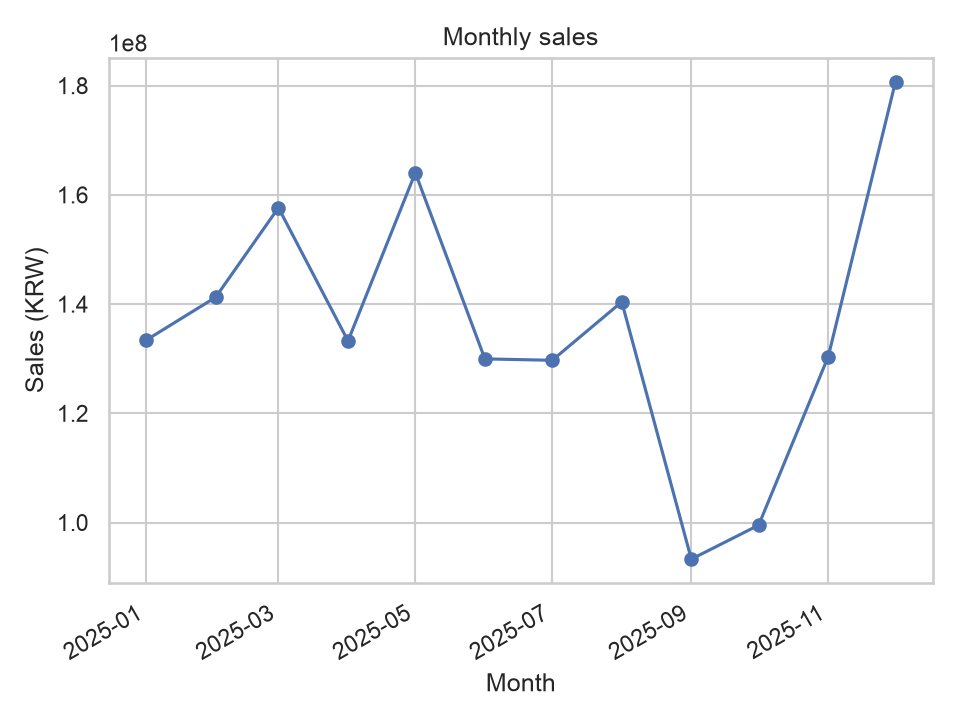
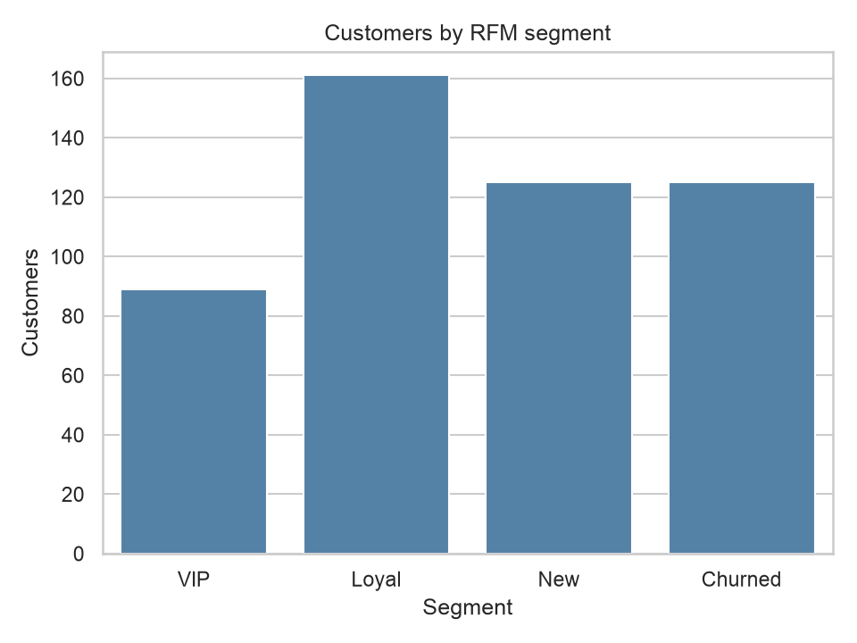

# 쇼핑몰 단골 고객 분석

코디세이 AI/SW 심화 데이터 분석 과제용 Python 프로젝트다. 2025년의 가상 쇼핑몰 거래를 탐색하고 최근 구매 경과일, 구매 빈도, 총구매금액을 활용해 고객을 네 그룹으로 분류한다.

## 발표하며 읽는 설명

약 7~10분을 기준으로 작성했다. 인용문은 발표할 때 읽을 내용이며, **화면 안내**는 보여줄 자료다. 아래 순서로 README를 내려가며 설명할 수 있다. 세부 코드와 설정은 뒤의 개발 문서에서 확인한다.

### 프로젝트를 소개합니다

> 안녕하세요. 쇼핑몰 단골 고객 분석 프로젝트를 발표하겠습니다.
>
> 이 프로젝트의 목표는 구매 기록을 살펴보고, 최근에 구매한 고객, 자주 구매한 고객, 구매금액이 큰 고객을 구분하는 것입니다. 이를 위해 데이터를 정리하고 그래프로 확인한 뒤, RFM이라는 방법으로 고객을 네 그룹으로 나눴습니다.
>
> Python으로 구현했고, NumPy는 이미지 숫자 계산에, Pandas는 표 형태의 데이터 처리에 사용했습니다. 그래프는 Matplotlib와 Seaborn으로 만들고, 분석 과정은 Jupyter Notebook에 기록했습니다.

### 어떤 데이터를 사용했는지 설명합니다

**화면 안내** — 아래 요약표를 보여준다.

| 항목 | 데이터 규모 |
|---|---:|
| 분석 기간 | 2025년 1월 1일~12월 31일 |
| 고객 | 500명 |
| 상품 | 100개 |
| 고유 주문 | 3,877건 |
| 상품 거래행 | 7,738행 |
| 원본 컬럼 | 10개 |

> 실제 고객의 개인정보를 사용하지 않고, Python으로 가상의 구매 기록을 만들었습니다. 합성 데이터 사용은 과제 담당자의 허용을 전제로 합니다.
>
> 고객마다 구매 횟수와 구매 시기, 선호 가격대가 다르게 나타나도록 설정했습니다. 난수 시드라는 무작위 숫자의 출발점도 고정해 같은 데이터를 다시 만들 수 있게 했습니다.
>
> 한 주문에서 상품을 여러 종류 살 수 있기 때문에 주문 수와 데이터 행 수가 다릅니다. 예를 들어 한 번 주문하면서 상품 세 종류를 샀다면 데이터는 세 행이지만, 주문 횟수는 한 번입니다.
>
> 가격과 수량 같은 숫자, 카테고리와 상품명 같은 문자, 주문 날짜, 이미지 배열을 함께 사용했습니다. 이미지는 가로와 세로가 각각 8칸이고, 각 칸에 밝기를 나타내는 숫자가 들어 있습니다.

### 코드를 어떻게 나눴는지 설명합니다

**화면 안내** — [데이터 생성 코드](src/generate_data.py)와 [분석 코드](src/pipeline.py)의 파일명을 보여준다.

> 데이터 생성과 분석을 별도 파일로 나눴습니다. generate_data.py는 데이터를 만들고, pipeline.py의 DataAnalyzer 클래스는 데이터를 읽고 정리하고 분석합니다.
>
> 클래스 안에서도 데이터 읽기, 빈칸 채우기, 이상치 찾기, 고객 분류를 각각 메서드로 나눴습니다. 메서드는 특정 작업을 수행하는 함수라고 생각하면 됩니다. 이렇게 나누면 어느 단계에서 문제가 생겼는지 확인하고 해당 기능을 다시 사용하기 쉽습니다.
>
> IQR 배수나 분석 기준일을 인자로 받을 수 있게 해서, 조건이 달라져도 함수에 전달하는 값을 바꿔 분석할 수 있게 했습니다.

### 빈칸과 이상치를 어떻게 처리했는지 설명합니다

> 먼저 head, info, describe로 데이터 일부와 자료형, 요약 통계를 확인했습니다.
>
> 상품명에는 의도적으로 만든 빈칸이 100개 있습니다. 같은 상품 ID에서 가장 자주 나온 이름으로 채워 빈칸을 0개로 줄였습니다. 같은 상품의 기존 이름을 활용한 것입니다. 다만 상품 ID가 잘못 연결돼 있으면 다른 이름이 들어갈 수 있으므로 ID 확인이 필요합니다.
>
> 다음으로 IQR을 사용해 유난히 큰 구매 수량을 찾았습니다. IQR은 값을 작은 순서로 놓았을 때 가운데 50퍼센트가 차지하는 범위입니다. 이 범위를 기준으로 아래와 위의 경계를 정했습니다.


> 이 데이터에서 경계는 마이너스 2개에서 6개였고, 범위를 벗어난 행은 24개였습니다. 전체의 약 0.31퍼센트입니다.
>
> 왼쪽은 원래 수량이고 오른쪽은 비교용으로 보정한 수량입니다. 최대 수량은 58개에서 6개로 줄어듭니다. 이 대량 구매는 유효한 거래로 생성했기 때문에 매출과 고객 분류에는 원래 거래금액을 사용했습니다.
>
> 평균과 표준편차를 사용하는 Z-score와도 비교했고, 이번 데이터에서는 같은 24행을 찾았습니다. 이 결과만으로 한 방법이 더 정확하다고 결론 내릴 수는 없습니다. IQR도 정상적인 대량 구매를 표시할 수 있습니다.

### 상품명과 이미지를 숫자로 바꾼 과정을 설명합니다

**화면 안내** — 노트북의 「텍스트·이미지 피처」 표를 함께 보여줄 수 있다.

> 분석에 사용할 수 있도록 상품명과 이미지에서 새로운 숫자 열을 만들었습니다. 상품명에서는 단어 수를 세었고, 이미지에서는 평균 밝기와 표준편차를 계산했습니다. 표준편차는 픽셀 밝기가 얼마나 서로 다른지 나타냅니다.
>
> 이미지마다 Python 반복문을 돌리는 대신, NumPy가 여러 이미지의 픽셀을 한꺼번에 계산하도록 했습니다. 같은 이미지가 여러 주문에 반복되면 한 번 계산한 결과를 각 주문에 연결합니다.
>
> 현재 이 피처들은 멀티모달 전처리 결과로 생성했습니다. 뒤에서 설명할 RFM은 구매 날짜, 주문 횟수, 구매금액을 이용합니다.

### 그래프에서 무엇을 확인했는지 설명합니다


> 히스토그램은 가격대별 상품 수를 보여줍니다. 상품 100개를 한 번씩 세었으며, 가운데 상품의 가격인 중앙값은 6만 7천 원입니다.
>
> 거래행 기준으로 계산하면 단가 중앙값은 8만 원입니다. 자주 팔린 상품이 반복해서 포함되기 때문에 상품 기준 그래프와 값이 다를 수 있습니다.


> 히트맵은 두 숫자가 함께 변하는 정도인 상관계수를 색으로 보여줍니다. 가격과 수량은 약 0.016으로 직선적인 관계가 약했습니다.
>
> 수량과 구매금액은 약 0.816으로 높게 나왔습니다. 구매금액을 가격 곱하기 수량으로 계산했기 때문에 계산식 자체의 영향도 들어 있습니다. 이 수치로 고객 행동의 원인과 결과를 단정할 수는 없습니다.


> 산점도에서는 대부분의 거래가 수량 1개에서 3개에 모여 있고, 위쪽에 일부 대량 구매가 보입니다. 앞에서 찾은 이상치가 실제 분포에서 어디에 있는지 확인할 수 있습니다.



> 월별 매출은 그 달의 거래금액을 모두 더한 값입니다. 12월이 약 1억 8천75만 원으로 가장 높고, 9월이 약 9천329만 원으로 가장 낮습니다.
>
> 합성 데이터에서 설정한 구매 시기의 영향이 있으므로 실제 쇼핑몰의 계절적 수요라고 일반화하기는 어렵습니다.

### RFM으로 고객을 나눈 기준과 결과를 설명합니다

> RFM은 고객을 세 가지 기준으로 보는 방법입니다. R은 마지막 구매 후 며칠이 지났는지, F는 몇 번 주문했는지, M은 총 얼마를 구매했는지입니다.
>
> 기준일은 마지막 거래일인 2025년 12월 31일입니다. 최근에 사고, 자주 사고, 많이 구매할수록 높은 점수를 받도록 각 지표를 1점에서 5점으로 바꿨습니다.
>
> 그룹은 아래 순서대로 처음 맞는 조건에 배정합니다. 그래서 한 고객이 여러 그룹에 중복되지 않습니다.

| 배정 순서 | 그룹 | 설명 | 고객 수 |
|---|---|---|---:|
| 1 | Churned, 이탈 위험 | 마지막 구매 후 90일 이상 | 125명 |
| 2 | New, 최근 첫 구매 | 관측된 첫 구매 후 30일 이내이며 주문 2회 이하 | 125명 |
| 3 | VIP | 주문 3회 이상이며 R·F·M 각각 4점 이상 | 89명 |
| 4 | Loyal | 앞선 조건에 해당하지 않는 고객 | 161명 |



> 가장 큰 그룹은 Loyal 161명입니다. VIP는 89명으로 전체 고객의 17.8퍼센트이지만, 전체 구매금액의 약 40.3퍼센트를 차지했습니다.
>
> New의 첫 구매는 이 데이터에서 관측한 첫 주문을 뜻합니다. 실제 가입일은 알 수 없습니다. Churned 역시 90일 동안 구매가 없었던 이탈 위험 후보이며, 실제 이탈을 확인한 결과는 아닙니다. Loyal은 남은 고객을 묶은 이름이므로 추가 구매 이력으로 특성을 더 확인할 필요가 있습니다.

### 분석을 바탕으로 제안할 행동을 설명합니다

> 첫째, 매출 기여가 높은 VIP에게 신상품 선공개를 제공해 구매 유지 효과를 시험할 수 있습니다. 30일 재구매율과 고객당 구매금액을 확인하겠습니다.
>
> 둘째, New 125명 중 한 번만 주문한 고객은 69명입니다. 이들에게 첫 구매와 함께 쓰기 좋은 상품을 안내하고, 30일 안에 두 번째 구매를 하는 비율을 확인하겠습니다.
>
> 셋째, Churned는 마지막 구매 후 평균 약 159일이 지났습니다. 이전에 산 상품군의 재입고 소식을 보내 재구매를 유도하고, 30일 재구매율을 확인하겠습니다.
>
> 효과를 검증하려면 각 그룹에서 무작위로 안내를 받은 고객과 대조군을 나눠 비교해야 합니다. 제안한 행동의 효과는 실제 실험으로 확인할 과제입니다.

### 실행 결과를 보여주고 마무리합니다

**화면 안내** — 터미널에서 테스트를 실행하고, 저장된 노트북과 그래프 파일을 보여준다.

```bash
source .venv/bin/activate
python -m unittest discover -s tests -v
```

> 테스트는 데이터 조건, 빈칸 처리, 이미지 계산, 주문 중복 집계 방지, 고객 분류 결과를 검사합니다. 실행 결과에서 테스트 개수와 OK를 확인하겠습니다.

**화면 안내** — 노트북을 새로 실행할 때는 다음 명령을 사용한다. 종료를 기다린 뒤 결과를 설명한다.

```bash
python -m nbconvert --execute --to notebook --inplace notebooks/analysis_report.ipynb
echo "실행 종료 코드: $?"
```

> 노트북은 데이터 읽기부터 전처리, 통계, 그래프, RFM까지 순서대로 실행합니다. 완료되면 실행 결과가 노트북에 저장되고, reports/figures 폴더에 그래프 6종도 만들어집니다.
>
> 이번 프로젝트에서 거래를 어떤 단위로 세는지와 이상치를 어떻게 다루는지가 분석 결과에 중요하다는 것을 배웠습니다. 실제 적용에서는 고객 구매 주기와 더 긴 과거 이력을 확보해 분류 기준과 캠페인 효과를 검증하겠습니다.


## 개발 환경

Python 3.8 이상, NumPy, Pandas, Matplotlib, Seaborn, Jupyter Notebook을 사용한다. 이미지 복원과 피처 계산에는 표준 라이브러리 JSON과 NumPy를 사용한다.

## 데이터와 생성 가정

`data/raw/ecommerce.csv`는 `src/generate_data.py`가 시드 `20251117`로 직접 생성한 합성 데이터다. **합성 데이터 사용은 과제 담당자의 허용을 전제로 한다.** 실제 쇼핑몰·고객·거래 데이터를 사용하지 않았다.

기본 시드의 관측 기간은 2025년 1월 1일부터 12월 31일까지다. 가상 고객 500명, 상품 100개, 주문 3,877건, 상품 거래행 7,738개가 있다. 한 행은 한 주문에 포함된 상품 한 종류다.

| 컬럼 | 설명 |
|---|---|
| `customer_id`, `order_id`, `product_id` | 고객, 주문, 상품의 가상 식별자 |
| `order_date` | 주문 날짜 |
| `product_name` | 가상 상품명 |
| `category` | 의류, 신발, 가방, 생활용품, 전자기기 |
| `price`, `quantity`, `amount` | 가상 단가(원), 수량, 구매금액(단가 × 수량) |
| `image_array` | JSON으로 저장한 8×8 회색조 픽셀 배열 |

구매 횟수, 활동 시기, 선택하는 상품 가격대를 달리한 네 가지 생성 패턴에 고객을 125명씩 배정한다. 주문당 서로 다른 상품 1~3종을 선택한다. 상품명 100행에 결측을 넣고, 별도로 24행에 대량 구매 수량을 부여한다. 상품 이미지는 카테고리별 도형 패턴과 난수를 조합해 NumPy로 만들며, 픽셀 범위는 0~255다. 고객 세그먼트는 생성 패턴 라벨 대신 거래 내역에서 계산한다.

## 프로젝트 구조

```text
data/raw/ecommerce.csv             합성 거래 원본
data/processed/                    노트북에서 생성하는 분석 CSV
src/__init__.py                    Python 패키지
src/generate_data.py               합성 데이터 생성
src/pipeline.py                    DataAnalyzer 분석 모듈
notebooks/analysis_report.ipynb    분석 보고서와 차트 6종
tests/test_pipeline.py             데이터·분석 검증
reports/figures/                   노트북에서 생성하는 차트 PNG 6종
requirements.txt                   실행 환경 의존성
README.md                          데이터·분석·실행 안내
.gitignore                         로컬 환경과 파생 산출물 제외
```

## 설치 및 실행

저장소 루트에서 실행한다.

```bash
python3 -m venv .venv
source .venv/bin/activate
python -m pip install -r requirements.txt
python -m src.generate_data
python -m unittest discover -s tests -v
jupyter notebook notebooks/analysis_report.ipynb
```

Jupyter에서 모든 셀을 순서대로 실행한다. 터미널에서 실행하려면 아래 명령을 사용한다.

```bash
python -m nbconvert --execute --to notebook --inplace notebooks/analysis_report.ipynb
```

노트북은 `data/processed/ecommerce_clean.csv`와 `data/processed/customer_rfm.csv`를 저장한다. 실행 결과가 포함된 노트북과 `reports/figures/`의 PNG 6종에서 동일한 차트를 확인할 수 있다.

실행 화면에서 nbconvert의 노트북 저장 메시지와 종료 코드 0을 확인할 수 있다. [실행 로그](reports/notebook_execution.log)와 [실행 결과가 포함된 노트북](notebooks/analysis_report.ipynb)도 함께 제공한다.


## 주요 분석

- `head()`, `info()`, `describe()`로 데이터 구조를 확인한다. 상품명 결측은 상품 ID별 최빈값으로 대치한다.
- IQR로 수량 이상치를 탐지하고, 비교용 수량 컬럼을 추가한다. 매출과 RFM은 관측 거래금액을 사용한다.
- 상품명 단어 수와 이미지 픽셀의 평균·표준편차를 계산한다. JSON 배열을 복원한 뒤 크기와 픽셀 범위를 확인하고 NumPy 축 연산으로 집계한다.
- 거래행 기준 기술통계와 피어슨 상관계수를 계산한다. 가격 히스토그램, 이상치 비교 박스플롯, 세그먼트 막대그래프, 상관 히트맵, 가격·수량 산점도, 월별 매출 라인차트를 그린다.

## DataAnalyzer 설계

`generate_data.py`는 합성 데이터를 재현하는 책임을, `pipeline.py`는 입력 CSV를 분석하는 책임을 맡는다. 이 구조에서는 분석기 호출자가 데이터 생성 시드나 고객 행동 가정에 의존하지 않는다. 로드 단계에서 원본과 분석용 복사본을 분리하고, 탐지와 보정도 분리해 관측 거래금액으로 매출과 RFM을 집계할 수 있게 했다.

| 메서드 | 입력 → 처리 → 출력 | 분리한 이유 |
|---|---|---|
| `load_data()` | 생성자에서 받은 CSV 경로 → 로드·날짜 파싱 → 분석용 DataFrame과 원본 복사본 | 실행마다 같은 원본으로 시작 |
| `handle_missing()` | 대상 열·그룹·전략 → `handle_missing_values()` 호출 → 대치된 Series | 사전평가 메서드명을 기존 동작에 연결 |
| `handle_missing_values()` | 대상 열·그룹·전략 → 그룹 통계와 전체 통계로 대치 → 대치된 Series | PDF의 필수 API와 기존 호출을 유지하면서 대치 로직을 한 곳에 보관 |
| `detect_outliers()` | 열·IQR 배수 → 경계 밖 행 선택 → 이상치 행 복사본 | 탐지 결과를 검토한 뒤 보정 여부를 결정 |
| `add_clipped_feature()` | 열·IQR 배수 → 별도 비교 열 생성 → 보정값 Series | 관측값을 보존한 상태로 분포 비교 |
| `add_text_features()` | 상품명 열 → 공백 기준 단어 수 → `name_word_count` | 텍스트 처리 규칙을 독립적으로 검증 |
| `add_image_features()` | 이미지 열·배열 모양 → 복원·검증·축 연산 → `image_mean`, `image_std` | 배열 유효성과 피처 계산을 독립적으로 검증 |
| `descriptive_statistics()` | 수치 열 목록 → 기초통계 계산 → 변수별 요약표 | 차트와 분리해 숫자를 재사용 |
| `correlations()` | 수치 열 목록 → 피어슨 상관 계산 → 상관행렬 | 표와 히트맵에 동일한 계산값 사용 |
| `monthly_sales()` | 일자·금액 열 → 달력 월별 금액 합산 → 월별 Series | 시계열 집계 단위를 명시 |
| `calculate_rfm()` | 고객·주문·일자·금액 열과 기준일·임계값 → 고객별 집계·점수·배정 → 고객별 표 | 고객별 계산과 요약 출력을 분리 |
| `summarize_segments()` | 고객별 RFM 표 → 그룹 수·평균·총액 집계 → 그룹별 표 | 보고서와 막대그래프가 같은 집계를 사용 |

### 파라미터 사용 가이드

기존 기본값은 과제 데이터에 맞춰 두었다. 열 이름, 이미지 모양, 운영 기준을 인자로 넘기면 같은 분석기를 다른 스키마나 기간에도 사용할 수 있다.

| 인자 | 기본값 | 바꾸는 상황과 영향 |
|---|---|---|
| 생성자 `data_path`, `save_processed(output_path)` | 필수 인자 | 데이터 위치와 결과 경로를 지정한다. 분석 저장 경로는 원본 경로와 구분한다. |
| `explore(rows)` | `5` | 수동 탐색 표본 행 수를 조정한다. 집계 자체에는 영향이 없다. |
| 대치의 `column`, `group_col`, `strategy` | `product_name`, `product_id`, `mode` | SKU별 동일 이름 복원에 사용한다. 수치형 열에는 `median` 또는 `mean`을 적용할 수 있으며 그룹 기준과 전략에 따라 대치값이 달라진다. |
| `iqr_bounds` / `detect_outliers` / `add_clipped_feature`의 `column`, `threshold` | 경계 함수에서 `column` 필수, 탐지·보정은 `quantity`, 배수 `1.5` | 검사할 수치 열을 바꾸거나 배수를 높여 경계를 넓힐 수 있다. 전후 비교에는 같은 열과 배수를 사용한다. |
| `add_text_features(column)` | `product_name` | 다른 문자열 열의 단어 수를 계산한다. |
| `add_image_features(column, image_shape)` | `image_array`, `(8, 8)` | 저장 열과 고정 해상도·채널 모양을 지정한다. 형태가 섞여 있으면 입력에서 먼저 통일해야 한다. |
| `descriptive_statistics(columns)` / `correlations(columns)` | `("price", "quantity", "amount")` | 분석할 수치 변수와 출력 표의 범위를 바꾼다. |
| `monthly_sales(date_col, amount_col)` | `order_date`, `amount` | 날짜형으로 준비된 주문일과 분석에 사용할 관측 금액 열을 고른다. |
| RFM `customer_col`, `date_col`, `amount_col`, `order_col` | `customer_id`, `order_date`, `amount`, `order_id` | 다른 거래 스키마에 맞춘다. `order_col`은 주문 내 여러 행을 하나의 주문으로 집계하는 키다. |
| RFM `reference_date` | `None`이면 마지막 거래일 | 캠페인 기준일을 명시할 수 있다. 기준일을 뒤로 옮기면 구매 경과일이 늘고 배정이 달라질 수 있다. |
| RFM `churn_days`, `new_days`, `vip_min_score` | `90`, `30`, `4` | 구매 주기·신규 혜택 기간·VIP 대상 규모에 맞춘다. 기준에 걸리는 고객군과 캠페인 모수가 달라진다. |
| `summarize_segments(customers)` | RFM 고객별 표 필수 | 집계 대상 고객 표를 선택한다. 필터링한 표를 넣으면 그 고객만 집계된다. |

### 전처리 판단과 통계적 한계

상품 ID별 최빈값은 동일 SKU의 관측 상품명을 이용해 결측을 복원한다. ID가 잘못 연결되거나 그룹 전체가 비어 있으면 다른 상품명이 대입될 수 있다. 노트북은 이름별 빈도와 카테고리별 고유 이름 수, 최빈 이름 비중, 엔트로피를 대치 전후 비교한다. 일반적인 그룹별 최빈값 대치에서는 특정 범주의 비율이 커지거나 그룹 간 차이가 실제보다 크게 보일 수 있다.

구매 수량은 이산적이고 오른쪽 꼬리가 길어 중앙 50%에 기초한 IQR을 사용했다. 노트북에서 절댓값 3 초과 Z-score 판정과 IQR 판정을 행 단위로 비교한다. IQR도 긴 꼬리의 정상 거래를 표시할 수 있다. 생성 단계에서 유효한 대량 구매로 설정한 행은 관측 금액을 집계에 쓰고, 수량 보정은 전후 비교용으로 적용했다.

### NumPy 벡터화와 이미지 처리 확장성

`add_image_features()`는 거래행에 반복되는 JSON을 고유 문자열 단위로 복원한 뒤, 같은 모양의 이미지를 숫자 배열로 쌓는다. 이 배열은 동일한 dtype의 원소를 메모리에 저장하며, 이 입력을 배열로 쌓으면 행 우선 연속 배치로 만들어져 인접 픽셀 접근에 유리하다. `pixels.mean(axis=axes)`와 `pixels.std(axis=axes)`는 픽셀마다 Python 객체를 꺼내 연산하는 반복문 대신 컴파일된 루프에서 픽셀 축을 일괄 집계한다. dtype, 메모리 배치, NumPy 빌드, CPU가 적합하면 내부 커널이 SIMD를 활용할 수 있다. 이 프로젝트에서는 계산 일치를 테스트했으며 실행 시간의 배율은 측정하지 않았다.

현재 데이터는 고유 이미지 100개, 이미지당 64픽셀이다. 대규모 거래에서는 JSON 파싱과 CSV 읽기가 먼저 병목인지 측정하고, 파싱 시간·배열 집계 시간·거래행 결합 시간·최대 메모리를 각각 확인한다. 배열 자체는 대략 `고유 이미지 수 × 높이 × 너비 × 채널 수 × dtype 바이트`를 사용하며, 디코딩 객체와 집계 임시 배열의 메모리는 별도다. 가로·세로 해상도가 각각 두 배면 픽셀당 연산량과 배열 크기는 약 네 배가 된다.

규모가 커지면 고유 상품 및 이미지 버전별 피처를 한 번 생성한 후 상품 ID로 거래행과 결합하고, 이미지 배치와 거래 CSV 청크를 나눠 전체 메모리 적재를 피한다. 분포 탐색에는 카테고리·해상도별 층화 표본을 쓸 수 있으며, 고객 RFM과 매출 총계에는 전체 거래를 사용한다. JSON 파싱이 병목이면 프로세스별 이미지 배치를 고려하되, 프로세스 시작·직렬화·데이터 복사 비용도 함께 비교한다. 위 확장 전략은 설계 제안이다.

## RFM 고객 분류

R은 마지막 거래일 기준 최근 구매 후 경과일, F는 고객별 고유 주문 수, M은 고객별 총구매금액이다. 각 지표의 평균 순위 백분율에 5를 곱하고 올림해 1~5점을 계산한다. R은 작을수록, F와 M은 클수록 높은 점수를 받는다.

표의 순서대로 처음 충족하는 그룹에 배정한다. 첫 구매일은 관측 기간에 확인한 최초 주문일이다. 5등급은 세 지표를 같은 척도로 비교하기 위한 선택이다. VIP 기준 4점은 세 지표에서 모두 높은 순위인 고객에 혜택을 집중하기 위한 초기 규칙이다. New의 30일은 두 번째 주문을 측정할 캠페인 기간, Churned의 90일은 재활성화 후보를 정하는 운영 가정이다. Loyal은 앞선 규칙에 해당하지 않는 나머지 그룹이다. 실제 적용에서는 고객당 매출·재구매율·혜택 비용으로 임계값을 검증한다.

| 순서 | 그룹 | 배정 기준 | 고객 수 | 평균 구매금액 | 평균 주문 수 | 평균 최근 구매 경과일 |
|---|---|---|---:|---:|---:|---:|
| 1 | Churned | 최근 구매 후 90일 이상 | 125 | 1,783,960원 | 4.94 | 159.35일 |
| 2 | New | 첫 구매 후 30일 이내, 주문 2회 이하 | 125 | 505,400원 | 1.45 | 11.10일 |
| 3 | VIP | 주문 3회 이상, R·F·M 모두 4점 이상 | 89 | 7,389,022원 | 14.64 | 9.38일 |
| 4 | Loyal | 나머지 고객 | 161 | 4,284,292원 | 11.02 | 25.79일 |

## 비즈니스 인사이트

1. **VIP 구매 유지**. VIP 89명은 전체 고객의 17.8%이며 구매금액의 40.3%를 차지한다. VIP를 대상으로 관심 상품군의 신상품 선공개를 시험해 재구매 유지 효과를 확인한다. 캠페인 노출 기록과 무작위 대조군을 확보해 30일 재구매율과 고객당 구매금액을 비교한다.
2. **New 고객의 두 번째 구매 유도**. New 125명의 평균 주문 횟수는 1.45회이고, 실제 안내 대상인 단일 주문 고객은 69명이다. 이 그룹의 단일 주문 고객에게 첫 주문 품목과 함께 쓰기 좋은 상품을 안내해 두 번째 구매를 유도한다. 관측 개시일 이전 구매 이력과 메시지 노출 기록을 확보해 대조군의 30일 두 번째 구매율과 비교한다.
3. **Churned 고객의 재구매 실험**. Churned 125명의 최근 구매 경과일은 평균 159.35일이며 과거 주문은 평균 4.94회다. 이전 구매 상품군의 재입고를 알려 재구매율 개선을 시험한다. 품목별 구매 주기와 캠페인 노출 기록을 확보하고 대조군과 30일 재구매율을 비교한다.

세그먼트 비중과 매출은 구매 패턴과 대량 거래를 설계한 가상 환경에서 관측한 값이다. 실제 쇼핑몰 고객 행동이나 캠페인 성과에 일반화할 수 없다.

캠페인의 우선순위는 VIP의 구매금액 기여도 40.3%, New의 단일 주문 대상 69명, Churned의 평균 구매 경과일 159.35일을 근거로 정한다. 각 세그먼트 안에서 고객을 무작위 배정하고 동일한 30일 관측창에서 대상과 대조군을 비교한다. 검증 데이터에는 가상 또는 가명 `customer_id`, `segment_at_assignment`, `assigned_at`, `experiment_arm`, `exposed_at`, `order_id`, `order_date`, `amount`를 기록한다. 효과는 배정된 전체 고객을 기준으로 지표 차이와 신뢰구간을 확인한다. 구매 이력이 충분한 실제 거래 데이터에서 실험해야 한다.

## 향후 머신러닝 확장 설계

추후에는 기준일 `t` 이전까지 주문한 고객의 **향후 30일 재구매 여부**를 예측 과제로 정의할 수 있다. 타깃은 `(t, t+30일]`에 고유 주문이 있으면 1, 완전한 30일 관측창에 주문이 없으면 0이다. 관측창 끝까지 데이터가 확보된 고객만 평가에 포함한다. 후보 피처는 `t`까지의 RFM, 평균 주문 금액, 고유 구매 상품 수, 선호 카테고리, 주문 간격이다.

거래·상품·고객 정보를 기준일에 이용 가능했던 값으로 조인하고 이후 거래는 타깃 계산에만 사용한다. 먼저 발생한 기준일을 학습용, 이후 기준일을 검증·평가용으로 나누고, 분할 경계에서 학습용 타깃 기간이 다음 평가 기준일을 넘는 관측치는 제외한다. PR-AUC, 캠페인 예산 내 상위 고객의 정밀도와 재현율, 확률 보정 정도를 지표 후보로 삼는다. 재구매 행동과 기간별 변화가 들어 있는 실제 거래 이력이 필요하다. 현재 합성 데이터로는 설계만 설명한다.
